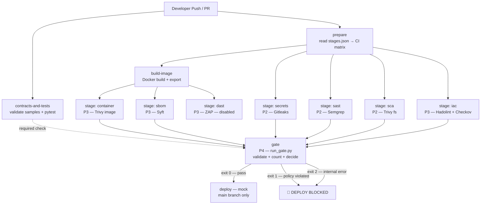

# P1 Architecture

## Overview

Phase 1 establishes the complete structural skeleton and frozen contracts of the DevSecOps pipeline. No real scanning happens yet — every stage is a stub that copies a pre-built sample SARIF. The design ensures P2, P3, and P4 can build their components in parallel without ever modifying files outside their own folders.

---

## Pipeline Mermaid Diagram



---

## Component Table

| Component | Path | Phase | Purpose |
|---|---|---|---|
| Contracts | `contracts/` | P1 (frozen) | Schemas, profiles, interfaces — the shared language |
| Validator | `contracts/validate.py` | P1 (frozen) | SARIF + policy checker; `extract_findings()` API |
| Stage stubs | `stages/*/run.sh` | P1 → P2/P3 | Replaceable scanner scripts |
| Gate stub | `gate/run_gate.py` | P1 → P4 | Policy engine (stub always passes) |
| Demo app | `demo-app/vulnerable/` | P1 | Scanner target with 8 seeded vulnerabilities |
| Samples | `contracts/samples/` | P1 | Ground-truth SARIF for stub stages |
| Workflow | `.github/workflows/pipeline.yml` | P1 (frozen) | CI orchestration |
| Registry | `stages/stages.json` | P1 | Drives the CI matrix |

---

## Stage Interface

Every stage follows exactly:

```
stages/<name>/run.sh <target_path> <output_dir>
  → <output_dir>/<name>.sarif (always)
  → exit 0: scan completed
  → exit 1: tool crashed
  → exit 2: usage error
```

See `contracts/stage-interface.md` for the complete specification.

---

## Gate Interface

```
python gate/run_gate.py --reports <dir> --policy <file> --out <dir>
  → <out>/gate-result.json
  → <out>/findings.json
  → exit 0: pass / exit 1: policy violated / exit 2: error
```

See `contracts/gate-interface.md` for the complete specification.

---

## Why Contracts Are Frozen

The contracts define the one shared format that connects:
- Every scanner → SARIF (profile in `sarif-profile.md`)
- SARIF → gate (via `extract_findings()` in `validate.py`)
- Gate → deploy decision (via `gate-result.json`)

If contracts change mid-project, every phase must update simultaneously. Freezing them now allows P2, P3, and P4 to build and test independently using sample data, with the guarantee that their output will be accepted by the gate.

---

## Merge-Conflict-Free Design

Each phase owns exactly one folder set (see `CODEOWNERS`). The only shared files are:
- `contracts/` — frozen, no edits without all-four-approval PR
- `.github/workflows/pipeline.yml` — P1 only; stages are added to the registry (`stages/stages.json`), never to the workflow
- `security-policy.yaml` — P4 only

A stage replacement (P2 or P3) only touches `stages/<name>/run.sh` and `stages/<name>/README.md` — no other file changes.
