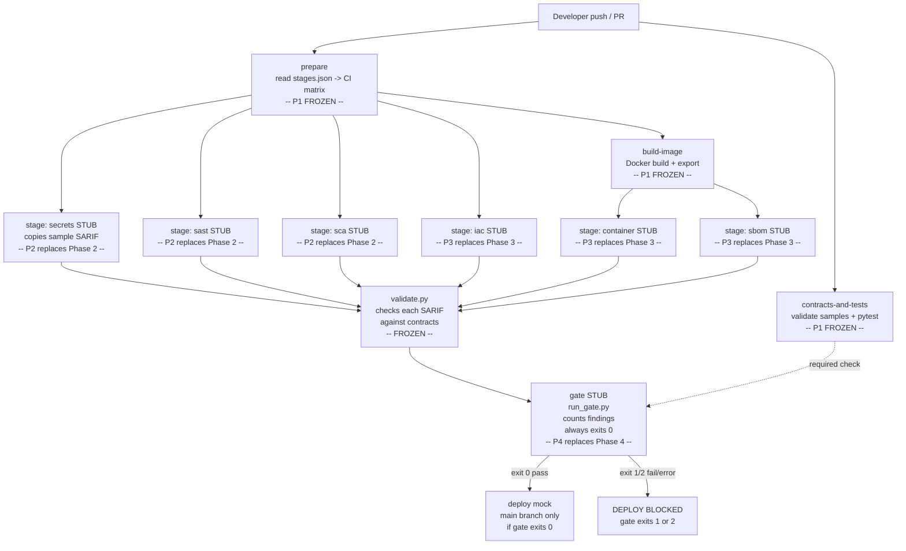

# Phase 1 Summary Report

**Project:** Automated Security Integration for CI/CD Pipelines  
**Phase:** 1 -- Foundation & Contracts  
**Owner:** P1  
**Date:** 2026-10-27  
**Overall status:** Complete with caveats

> This report is a short companion to [`docs/p1-implementation-report.md`](p1-implementation-report.md), which contains the full implementation record. All claims below were verified by reading files or running commands on 2026-10-27.

---

## 3.2 Project in 5 Lines

This project automatically runs security scans (secret detection, SAST, SCA, IaC, container, SBOM, DAST) on every commit and blocks deployment when findings exceed the team-defined thresholds. A policy gate reads all scanner outputs and decides pass or fail. Phase 1 builds the skeleton: frozen shared formats (contracts), a working validator, a demo app with deliberately planted vulnerabilities, placeholder scanner scripts (stubs) for all seven stages, a stub gate, and the GitHub Actions workflow that wires everything together. No real scanning happens yet -- every stage copies a pre-built sample SARIF. Phases 2 (P2), 3 (P3), and 4 (P4) replace each stub with real tools without touching any file outside their assigned folders.

---

## 3.3 What Phase 1 Delivered

| Deliverable | Status |
|---|---|
| Repo structure, CODEOWNERS, .gitignore, .gitattributes, PR template | **Done** |
| Frozen contracts: SARIF profile, finding schema, policy schema, severity map, stage and gate interfaces | **Done** -- pending all-four sign-off to make freeze official |
| Validator (contracts/validate.py) with extract_findings() API | **Done** |
| Demo app -- vulnerable Flask app with 8 seeded vulnerabilities (V1a-V8) | **Done** -- Docker build not verified (no daemon available) |
| Seeded vulnerability ground truth (JSON + Markdown + drift-protection test) | **Done** |
| Stub stages for secrets, sast, sca, iac, container, sbom (dast disabled) | **Done** |
| Stub gate (gate/run_gate.py) -- validates SARIFs, counts findings, always passes unless GATE_FORCE_FAIL=1 | **Done** |
| GitHub Actions workflow + local pipeline script + Makefile | **Done** -- not yet run on GitHub Actions (no first green run yet) |

---

## 3.4 Project Parts

| Part | One-line meaning |
|---|---|
| **A. Repository governance** | Ownership, PR rules, branch protection, ignore files |
| **B. Contracts** | The frozen shared formats and interfaces all phases obey |
| **C. Validator** | The tool that checks stage output against the contracts |
| **D. Demo application** | The vulnerable and fixed Flask apps used as the scan target |
| **E. Seeded vulnerability ground truth** | The list of planted flaws used to measure detection in Phase 5 |
| **F. Pipeline stages (stubs)** | One folder per scan stage, currently placeholders |
| **G. Policy gate (stub)** | The pass/fail decision step, currently a placeholder |
| **H. CI/CD workflow** | The GitHub Actions pipeline and its composite action |
| **I. Local tooling** | Makefile and script for running the pipeline locally |
| **J. Documentation** | Architecture, contribution guides, sign-off, reports |
| **K. Evaluation placeholders** | Empty folders reserved for each person's performance data |

---

## 3.5 File-by-File Summary

### Part A -- Repository Governance

| File | What it is | Role in the project | Owner | Status | Next phase |
|---|---|---|---|---|---|
| `.gitignore` | Standard ignore patterns for Python, venvs, reports, IDE files, secrets, DB files. | Prevents build artefacts, local .env files, and SQLite databases from being committed accidentally. | P1 | Done | Frozen |
| `.gitattributes` | Line-ending normalization rules for all text and binary file types. | Ensures shell scripts always use Unix LF so they execute correctly on GitHub Actions Linux runners. | P1 | Done | Frozen |
| `.gitleaks.toml` | Gitleaks allowlist config scoping the fake-key exemption to demo-app/vulnerable/. | Prevents the pipeline's own secrets scanner from false-positiving on the intentionally planted fake credentials. | P1 | Done | Frozen |
| `CODEOWNERS` | Maps file path patterns to GitHub handles @p1-handle through @p4-handle; contracts/ requires all four. | Enforces ownership boundaries via GitHub's required-reviewer mechanism so no one edits files outside their scope. | P1 | Done -- handles are placeholders, not real usernames | P1 maintains |
| `.github/pull_request_template.md` | 7-item PR review checklist covering ownership, validation, tests, secrets, docs, and contracts. | Ensures every contributor self-checks ownership and contract stability before requesting a review. | P1 | Done | Frozen |
| `docs/branch-protection.md` | Required branch protection settings plus exact gh api CLI commands to apply them. | Gives a team admin the precise steps to lock main so the CI gate is mandatory and direct pushes are blocked. | P1 | Done -- not yet applied (requires admin action) | P1 maintains |

### Part B -- Contracts

| File | What it is | Role in the project | Owner | Status | Next phase |
|---|---|---|---|---|---|
| `contracts/finding.schema.json` | JSON Schema (draft 2020-12) defining 8 required and 9 optional fields for a normalized security finding. | Every stage and the gate agree on this shape so findings can be aggregated and waived without parsing each tool's native format. | All 4 (P4 leads) | Done | Frozen |
| `contracts/policy.schema.json` | JSON Schema defining the structure of security-policy.yaml (version, mode, thresholds, waivers). | Validated by the gate before any policy evaluation; prevents misconfigured policies from silently passing or blocking. | All 4 | Done | Frozen |
| `contracts/sarif-profile.md` | 150-line spec defining which SARIF 2.1.0 fields are mandatory and how they map to finding fields. | Defines the exact SARIF subset P2 and P3 must emit so validate.py can check it and the gate can parse it. | All 4 | Done | Frozen |
| `contracts/severity-map.md` | Table mapping each tool's native severity labels to Critical / High / Medium / Low. | Gives P2 and P3 a definitive reference so all tools' outputs land on the same four-level scale the gate counts against. | All 4 | Done | Frozen |
| `contracts/stage-interface.md` | 128-line spec: CLI invocation, exit codes, output paths, logging rules, idempotency, extract_findings signature. | Decouples every stage from the workflow -- stages need only satisfy this interface; the pipeline never changes when a scanner changes. | All 4 | Done | Frozen |
| `contracts/gate-interface.md` | 138-line spec: gate CLI args, exit codes, gate-result.json and findings.json schemas, GATE_FORCE_FAIL variable. | Decouples P4's gate implementation from the CI workflow; pipeline checks only exit code and reads only these two output files. | All 4 | Done | Frozen |
| `contracts/CHANGELOG.md` | Amendment log and four-member acknowledgement procedure for changing frozen contracts. | Forces any contract change to be discussed by all four members and recorded before a PR is opened. | All 4 | Done -- no amendments yet; v1.0.0 freeze pending sign-off | Frozen |
| `contracts/requirements.txt` | Three pinned packages: jsonschema==4.23.0, PyYAML==6.0.2, pytest==8.3.4. | Ensures the validator and tests run identically in every environment and in CI. | All 4 | Done | Frozen |
| `contracts/__init__.py` | One-line comment making contracts/ a Python package. | Required for `from contracts.validate import extract_findings` to work in the gate without path manipulation. | All 4 | Done | Frozen |
| `contracts/samples/secrets.sarif` | Valid sample SARIF for the secrets stage (Gitleaks, 1 High finding, driver version set). | Ground-truth output used by the stub stage and as the test input for validate.py tests. | All 4 | Done | Frozen |
| `contracts/samples/sast.sarif` | Valid sample SARIF for the sast stage (Semgrep, 1 High finding). | Same role as secrets.sarif for the sast stage. | All 4 | Done | Frozen |
| `contracts/samples/sca.sarif` | Valid sample SARIF for the sca stage (Trivy, CVE findings). | Same role for sca. | All 4 | Done | Frozen |
| `contracts/samples/iac.sarif` | Valid sample SARIF for the iac stage (Hadolint, 1 Medium finding). | Same role for iac. | All 4 | Done | Frozen |
| `contracts/samples/container.sarif` | Valid sample SARIF for the container stage (Trivy image scan, 1 Critical finding). | Same role for container. | All 4 | Done | Frozen |
| `contracts/samples/sbom.sarif` | Valid sample SARIF for the sbom stage (Syft, zero results -- inventory only). | Demonstrates that zero-result SARIFs are valid per the profile. | All 4 | Done | Frozen |
| `contracts/samples/dast.sarif` | Valid sample SARIF for the dast stage (ZAP, 1 Medium finding). | Same role for dast; stage is disabled in CI but sample is still validated. | All 4 | Done | Frozen |
| `contracts/samples/invalid/bad-severity.sarif` | SARIF with an invalid properties.severity value ("CRITICAL" instead of "Critical"). | Used in tests to verify the validator catches wrong-case severity. | All 4 | Done | Frozen |
| `contracts/samples/invalid/missing-driver-version.sarif` | SARIF with no tool.driver.version field. | Used in tests to verify the validator catches unpinned-tool SARIFs. | All 4 | Done | Frozen |
| `contracts/samples/invalid/missing-location.sarif` | SARIF result with no locations array. | Used in tests to verify the validator catches missing file paths. | All 4 | Done | Frozen |
| `contracts/samples/invalid/missing-rule-id.sarif` | SARIF result with no ruleId field. | Tests that missing rule ID is caught. | All 4 | Done | Frozen |
| `contracts/samples/invalid/not-json.sarif` | File containing plain text (not JSON). | Tests that the validator handles parse errors gracefully. | All 4 | Done | Frozen |
| `contracts/samples/invalid/wrong-sarif-version.sarif` | SARIF with "version": "2.0.0". | Tests that wrong SARIF version is caught. | All 4 | Done | Frozen |

### Part C -- Validator

| File | What it is | Role in the project | Owner | Status | Next phase |
|---|---|---|---|---|---|
| `contracts/validate.py` | 390-line Python CLI and importable module; validates SARIF and policy files; exposes extract_findings(). | The single enforcement point for all contracts: used by the gate, every stage test, the CI contracts-and-tests job, and the local pipeline runner. | All 4 (P4 leads) | Done | Frozen |
| `contracts/tests/__init__.py` | Empty file making contracts/tests/ a Python package. | Required for pytest discovery inside contracts/tests/. | All 4 | Done | Frozen |
| `contracts/tests/test_validate.py` | 328-line pytest file: 34 tests covering valid samples, invalid samples, policy validation, stage-category checks, exit codes, JSON output, and extract_findings. | Provides automated regression coverage so any change to validate.py is immediately caught. | All 4 | Done | Frozen |

### Part D -- Demo Application

| File | What it is | Role in the project | Owner | Status | Next phase |
|---|---|---|---|---|---|
| `demo-app/README.md` | Safety warnings, run instructions, Docker instructions, and pointers to ground-truth files. | Tells every team member how to use the demo apps safely and where to find seeded-vulnerability data. | P1 | Done | P1 maintains |
| `demo-app/vulnerable/app.py` | Flask app with three deliberately planted flaws: SQL injection (V2), MD5 password hashing (V6), debug=True (V7). | Provides a realistic Python target for SAST scanners to find code-level vulnerabilities. | P1 | Done | Frozen (scanner target) |
| `demo-app/vulnerable/config.py` | App configuration with two fake AWS credentials (V1a, V1b) and a weak SECRET_KEY. | Provides a realistic target for secrets scanning; credentials are documented fake values, not real. | P1 | Done | Frozen (scanner target) |
| `demo-app/vulnerable/requirements.txt` | Flask 1.1.4, Jinja2 2.11.3, Werkzeug 1.0.1 -- all intentionally outdated with known CVEs (V3a-V3c). | Provides a realistic SCA target; three CVEs verified with pip-audit on 2026-10-27. | P1 | Done | Frozen (scanner target) |
| `demo-app/vulnerable/Dockerfile` | FROM python:3.9 with no USER instruction, no HEALTHCHECK, no pinned digest (V4, V5, V8). | Provides a realistic target for IaC and container scanners. | P1 | Done -- Docker build not verified locally | Phase 3 |
| `demo-app/vulnerable/tests/__init__.py` | Empty package marker. | Required for pytest discovery inside demo-app/vulnerable/tests/. | P1 | Done | Frozen |
| `demo-app/vulnerable/tests/test_app.py` | Functional tests: health check, SQL injection route, login route, 401 path. | Confirms the app behaves correctly so scanners test real logic, not a broken app. | P1 | Done | Frozen |
| `demo-app/fixed/app.py` | Same Flask app with parameterised queries, bcrypt hashing, and debug=False. | Demonstrates the secure version; used in Phase 5 to show the fix resolves findings. | P1 | Done | Phase 3 |
| `demo-app/fixed/config.py` | Config reading all secrets from os.environ; raises ValueError if SECRET_KEY is absent. | Shows the correct pattern (env vars, not hardcoded values) and verifies it in tests. | P1 | Done | Frozen |
| `demo-app/fixed/requirements.txt` | Flask 3.1.0, Werkzeug 3.1.3, Jinja2 3.1.5, bcrypt 4.2.1 -- current, patched versions. | Demonstrates the SCA fix: upgrading to versions without known CVEs. | P1 | Done | Frozen |
| `demo-app/fixed/Dockerfile` | Flask app Dockerfile with non-root user and a digest-pinned base image. | Shows the IaC/container fix; P3 will harden this further in Phase 3. | P1 (handed to P3) | Done | Phase 3 |
| `demo-app/fixed/.env.example` | Template listing required environment variables with placeholder values. | Documents what variables operators must set; safely committed because it contains no real values. | P1 | Done | Frozen |
| `demo-app/fixed/tests/__init__.py` | Empty package marker. | Required for pytest discovery. | P1 | Done | Frozen |
| `demo-app/fixed/tests/test_app.py` | Functional tests for the fixed app (same routes, Flask 3.1.0, bcrypt). | Confirms the fixed app behaviour is identical to the vulnerable version so the fix is non-breaking. | P1 | Done | Frozen |
| `demo-app/tests/__init__.py` | Empty package marker. | Required for pytest discovery of drift-protection tests. | P1 | Done | Frozen |

### Part E -- Seeded Vulnerability Ground Truth

| File | What it is | Role in the project | Owner | Status | Next phase |
|---|---|---|---|---|---|
| `demo-app/seeded-vulnerabilities.md` | Human-readable table of all 11 seeded entries (V1a-V8): file, line, class, CVE/CWE, expected tool and rule. | Authoritative reference for Phase 5 evaluators computing detection rate, false-negative rate, and false-positive rate. | P1 | Done | Frozen |
| `demo-app/seeded-vulnerabilities.json` | Machine-readable version of the same data. | Input for the automated Phase 5 evaluation script and data source for the drift-protection pytest. | P1 | Done | Frozen |
| `demo-app/tests/test_seeded_vulns.py` | Drift-protection test: reads the JSON, finds each listed file, checks the expected pattern within +/-5 lines. | Alerts the team if a code refactor shifts a vulnerability line so the ground truth never goes stale. | P1 | Done | P1 maintains |

### Part F -- Pipeline Stages (Stubs)

All seven stage folders share the same three-file structure (run.sh, README.md, tests/run_test.sh).  
The `dast` stage is `enabled: false` in stages.json; it is excluded from the CI matrix and local pipeline, but its stub and test still work.

| Files | What they are | Role in the project | Owner | Status | Next phase |
|---|---|---|---|---|---|
| `stages/stages.json` | JSON registry of all 7 stages with name, owner, enabled flag, and needs_image flag. | Drives the GitHub Actions matrix job and local pipeline loop; adding or enabling a stage only requires editing this file. | P1 | Done | Phase 3 (enable dast) |
| `stages/secrets/run.sh`, `stages/sast/run.sh`, `stages/sca/run.sh` | Bash stubs (P2 stages): validate args, create output dir, copy sample SARIF, print stub banner, exit 0. | Placeholders so CI passes and the interface is exercised before P2 installs real tools. | P2 | Stub | Phase 2 |
| `stages/iac/run.sh`, `stages/container/run.sh`, `stages/sbom/run.sh`, `stages/dast/run.sh` | Bash stubs (P3 stages): same structure; sbom stub also writes a placeholder sbom.cdx.json. | Same placeholder role for P3 stages; sbom stub exercises the non-SARIF artifact output path. | P3 | Stub | Phase 3 |
| `stages/secrets/README.md`, `stages/sast/README.md`, `stages/sca/README.md` | Per-stage docs: purpose, real tool name with pinned version, install command, 4-step stub-replacement guide. | Gives P2 everything needed to replace a stub without consulting any other file. | P2 | Done | Phase 2 |
| `stages/iac/README.md`, `stages/container/README.md`, `stages/sbom/README.md`, `stages/dast/README.md` | Same structure for P3 stages. | Same role for P3. | P3 | Done | Phase 3 |
| `stages/secrets/tests/run_test.sh`, `stages/sast/tests/run_test.sh`, `stages/sca/tests/run_test.sh` | Integration test scripts: run stage in temp dir, assert SARIF exists, run validate.py --stage. | Verifies the stub satisfies the interface; P2 extends these when replacing the stub with a real scanner. | P2 | Stub | Phase 2 |
| `stages/iac/tests/run_test.sh`, `stages/container/tests/run_test.sh`, `stages/sbom/tests/run_test.sh`, `stages/dast/tests/run_test.sh` | Same test structure for P3 stubs; sbom test also asserts sbom.cdx.json exists. | Same role for P3. | P3 | Stub | Phase 3 |

### Part G -- Policy Gate (Stub)

| File | What it is | Role in the project | Owner | Status | Next phase |
|---|---|---|---|---|---|
| `gate/run_gate.py` | 237-line Python stub gate: validates all *.sarif files and the policy, counts findings by severity, writes gate-result.json and findings.json, exits 0 unless GATE_FORCE_FAIL=1. | Exercises the full gate interface so CI passes in Phase 1; P4 replaces only the internal policy logic (CLI args, exit codes, and output schemas are frozen). | P4 | Stub | Phase 4 |
| `gate/README.md` | Gate purpose, Phase 1 stub behaviour, frozen interface summary, demo command for forcing a fail. | Gives P4 the exact replacement scope without requiring them to read the full gate-interface contract first. | P4 | Done | Phase 4 |
| `gate/tests/test_gate_stub.py` | 5 pytest tests: all-pass, force-fail (exit 1), missing stage report (exit 2), empty reports dir (exit 2), invalid SARIF (exit 2). | Verifies all three exit codes and error paths so P4 can regression-test the real gate against the same suite. | P4 | Done | Phase 4 |

### Part H -- CI/CD Workflow

| File | What it is | Role in the project | Owner | Status | Next phase |
|---|---|---|---|---|---|
| `.github/workflows/pipeline.yml` | 400-line GitHub Actions workflow: contracts-and-tests, prepare, build-image, stage (matrix), gate, deploy (mock). | The CI implementation of the entire pipeline: validates contracts, runs all enabled stages in parallel, gates on policy, mock-deploys only when gate passes on main. | P1 | Done -- not yet run on GitHub Actions | Frozen |
| `.github/actions/run-stage/action.yml` | 43-line composite action: runs stages/<name>/run.sh, validates the SARIF with validate.py, prints grouped CI logs. | Keeps pipeline.yml short and ensures every stage output is always validated before being uploaded as an artifact. | P1 | Done | Frozen |

### Part I -- Local Tooling

| File | What it is | Role in the project | Owner | Status | Next phase |
|---|---|---|---|---|---|
| `Makefile` | 90-line Makefile with targets: help, setup, validate, test, pipeline-local, pipeline-local-fail, lint, clean. | Gives any team member a single entry point to reproduce CI locally; pipeline-local-fail demonstrates the block path without changing any file. | P1 | Done | P1 maintains |
| `scripts/run-local-pipeline.sh` | 147-line bash script: reads stages.json, runs each enabled stage, validates SARIF output, runs the gate, prints WOULD DEPLOY or DEPLOY BLOCKED. | Mirrors the CI pipeline locally so P2/P3/P4 can test their changes before pushing. | P1 | Done | P1 maintains |
| `conftest.py` | 5-line root pytest config that inserts the repo root into sys.path. | Allows `from contracts.validate import extract_findings` to work in any pytest session without installing the package. | P1 | Done | P1 maintains |

### Part J -- Documentation

| File | What it is | Role in the project | Owner | Status | Next phase |
|---|---|---|---|---|---|
| `README.md` | 74-line root readme: quick-start commands, project summary table, repo layout, ownership table, key document index. | First file every contributor reads; maps the repo and points to all major documents. | P1 | Done | P1 maintains |
| `docs/p1-architecture.md` | Pipeline Mermaid diagram, component table, stage and gate interface summaries, merge-conflict-free design explanation. | Explains why the repo is structured as it is and how each component connects to the others. | P1 | Done | Frozen |
| `docs/p1-assumptions.md` | 15 numbered decisions made during Phase 1 that the prompt did not dictate (line numbers, Flask test version, fake key choice, etc.). | Creates an audit trail so later phases understand why choices were made and can propose amendments with context. | P1 | Done | P1 maintains |
| `docs/p1-implementation-report.md` | Full 257-line Phase 1 implementation record: deliverables, post-review fixes, test evidence. | Primary formal record of Phase 1 work for the professor and team. | P1 | Done | P1 maintains |
| `docs/contributing.md` | Ownership model, branch naming, reviewer rotation, merge-ready checklist, stub-replacement guide (4 steps), contract amendment process. | Gives P2, P3, P4 everything they need to open a correct PR without asking P1. | P1 | Done | P1 maintains |
| `docs/branch-protection.md` | Required GitHub settings plus gh api commands to apply branch protection and enable push protection. | Provides the exact admin steps to enforce the CI gate on main. | P1 | Done -- admin action still required | P1 maintains |
| `docs/team-signoff.md` | Sign-off table with four rows (P1-P4), each with a checkbox, handle placeholder, and date field. | The real gate for freezing contracts; no freeze is official until all four boxes are ticked and merged. | All 4 | **Not signed** -- all checkboxes empty, handles are placeholders | Phase 1 maintains |
| `docs/p2-architecture.md` | One-line placeholder: "TODO: owned by P2". | Reserved location for P2's architecture document. | P2 | Placeholder | Phase 2 |
| `docs/p3-architecture.md` | One-line placeholder: "TODO: owned by P3". | Reserved location for P3's architecture document. | P3 | Placeholder | Phase 3 |
| `docs/p4-architecture.md` | One-line placeholder: "TODO: owned by P4". | Reserved location for P4's architecture document. | P4 | Placeholder | Phase 4 |

### Part K -- Evaluation Placeholders

| Files | What they are | Role in the project | Owner | Status | Next phase |
|---|---|---|---|---|---|
| `eval/p1-performance/.gitkeep`, `eval/p2-code/.gitkeep`, `eval/p3-container/.gitkeep`, `eval/p4-policy/.gitkeep` | Empty files that make four empty directories tracked by git. | Reserve the directory structure for each person's performance evaluation data, added during Phase 5. | P1/P2/P3/P4 resp. | Placeholder | Phase 5 |

---

## 3.6 How the Parts Connect

The CI workflow reads `stages/stages.json` to build a matrix of enabled stages. Each stage job runs through the `run-stage` composite action, which calls `run.sh` then immediately validates the SARIF. All stage artifacts are downloaded by the `gate` job, which applies `security-policy.yaml` and decides deployment. Today every stage box marked STUB copies a pre-built sample SARIF; the gate always passes. P2 replaces secrets/sast/sca, P3 replaces iac/container/sbom/dast, and P4 replaces the gate -- none of them touch the workflow, contracts, or each other's folders.

---

## 3.7 Verification Results

All commands run on 2026-10-27, Python 3.13.2, pytest 8.3.4, Windows 11 with Git Bash.

| Check | Command | Result | Key output |
|---|---|---|---|
| All 7 valid samples pass | `python contracts/validate.py contracts/samples/` | **Pass** exit 0 | VALID for all 7 *.sarif files |
| Baseline policy passes | `python contracts/validate.py security-policy.yaml --policy security-policy.yaml` | **Pass** exit 0 | VALID: security-policy.yaml |
| Invalid samples rejected (negative test) | Covered by test_invalid_sample_fails (6 parametrized pytest cases) | **Pass** each case exits 1 correctly | e.g. bad-severity.sarif fails with "severity" in output |
| Full test suite | `python -m pytest contracts/tests/ demo-app/tests/ gate/tests/ -v --tb=short` | **Pass** exit 0 | 62 passed in 9.05s |
| Local pipeline normal | `bash scripts/run-local-pipeline.sh demo-app/vulnerable` | **Pass** | WOULD DEPLOY -- Gate: PASSED, Stage failures: 0 |
| Local pipeline force-fail | `GATE_FORCE_FAIL=1 bash scripts/run-local-pipeline.sh demo-app/vulnerable` | **Pass** correctly blocked | DEPLOY BLOCKED -- Gate: POLICY VIOLATED |
| GitHub Actions first run | Not triggered yet | **Not verified** | Repo pushed 2026-10-27; no workflow run observed |
| Docker build | No Docker daemon available locally | **Not verified** | Documented in docs/p1-assumptions.md assumption A5 |

---

## 3.8 What Is Stubbed and Who Replaces It

| Stub | Replaced by | Owner | Phase | How it will be replaced |
|---|---|---|---|---|
| `stages/secrets/run.sh` | Real Gitleaks v8.18.4 invocation | P2 | 2 | Replace the cp body with gitleaks detect --source ... --report-format sarif; apply severity map; extend test. |
| `stages/sast/run.sh` | Real Semgrep invocation | P2 | 2 | Replace body with semgrep --config ... --sarif; map ERROR/WARNING/INFO to severity; extend test. |
| `stages/sca/run.sh` | Real Trivy filesystem scan | P2 | 2 | Replace body with trivy fs --format sarif; map CRITICAL/HIGH/etc.; extend test. |
| `stages/iac/run.sh` | Hadolint + Checkov | P3 | 3 | Replace body with both tool invocations merged into one SARIF; extend test. |
| `stages/container/run.sh` | Trivy image scan | P3 | 3 | Replace body with trivy image --format sarif $IMAGE_REF; extend test. |
| `stages/sbom/run.sh` | Syft CycloneDX generation | P3 | 3 | Replace body with syft -o cyclonedx-json plus zero-result SARIF; extend test. |
| `stages/dast/run.sh` | OWASP ZAP | P3 | 3 | Replace body and set enabled: true in stages.json; extend test. |
| `gate/run_gate.py` policy logic | Real threshold evaluation and waiver logic | P4 | 4 | Replace the stub decision block (lines 193-202) with real evaluation; keep CLI args and output schemas unchanged. |
| `docs/p2-architecture.md` | P2's architecture document | P2 | 2 | Write content replacing the "TODO" placeholder. |
| `docs/p3-architecture.md` | P3's architecture document | P3 | 3 | Same. |
| `docs/p4-architecture.md` | P4's architecture document | P4 | 4 | Same. |

---

## 3.9 Gaps, Risks, and Open Items

1. **CODEOWNERS uses placeholder handles.** All four entries are @p1-handle etc. GitHub will not enforce required reviews until real handles are substituted. **Action: each team member adds their real GitHub username.**

2. **Branch protection not applied.** The settings in `docs/branch-protection.md` have not been applied. Direct pushes to `main` are currently possible. **Action: a team admin must run the gh api commands in that document.**

3. **Contract sign-off not complete.** `docs/team-signoff.md` shows all four checkboxes empty. The contracts are in draft state; the freeze is not official. **Action: each member reads the contracts, checks their box, and a PR is opened and approved by all four.**

4. **GitHub Actions has never run.** The repo was pushed on 2026-10-27 and no workflow run has been observed yet. The demo-app/fixed tests may fail in CI because the fixed app raises ValueError if SECRET_KEY is absent and CI may not set it. **Action: trigger a push to main and review the first run carefully.**

5. **Docker builds not verified.** Neither demo-app/vulnerable/Dockerfile nor demo-app/fixed/Dockerfile has been built locally (no Docker daemon -- see assumption A5 in docs/p1-assumptions.md). **Action: P3 verifies both Dockerfiles build correctly as part of Phase 3.**

6. **GitHub push protection will flag the fake AWS key.** demo-app/vulnerable/config.py contains a fake AWS key pattern that GitHub Secret Scanning push protection will block. A .gitleaks.toml allowlist is in place for the pipeline's own scanner. The bypass procedure for GitHub push protection is documented in demo-app/README.md. **Action: follow the documented bypass steps when the first block occurs.**

7. **demo-app/vulnerable and demo-app/fixed unit tests not separately verified in this report.** The pytest session above covered demo-app/tests/ (drift tests) but not demo-app/vulnerable/tests/ or demo-app/fixed/tests/ in isolation. **Action: run `cd demo-app/vulnerable && pytest tests -q` and `cd demo-app/fixed && SECRET_KEY=test pytest tests -q`.**

8. **dast stage is disabled.** stages/stages.json sets enabled: false for dast. It will not run in CI and is not required for the gate to pass. This is intentional and should be re-evaluated when P3 implements ZAP in Phase 3.
