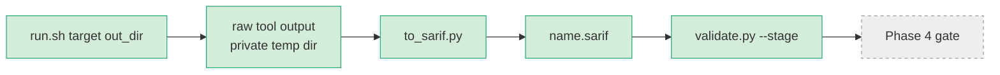

# P2 Implementation Report: Code Security Stages (Phase 2)

Written 2026-10-27 from what was built and run in the build sandbox (Python 3.12, no access to `semgrep.dev`, `ghcr.io`,
`mirror.gcr.io`; GitHub and PyPI reachable). Numbers come from `eval/p2-code/results.json` (commit `4c065d0`).

## 1. Executive summary

**Overall status: Complete with caveats.**
* `secrets` (Gitleaks 8.30.1) and `sast` (Semgrep 1.182.1) are implemented, tested and detect V1 and V2/V6/V7 on `demo-app/vulnerable`; both report 0 findings on `demo-app/fixed`.
* `sca` (Trivy 0.76.1) is implemented and tested (logic, converter on a real upstream Trivy report, fail-closed with the real binary). **V3 detection against the real vulnerability DB is not verified** (DB hosts blocked).
* `sast` was measured with local rules only; Semgrep registry packs were **not run**. The strict CI default (registry required) correctly fails closed here.
* Contract-valid, deterministic (secrets, sast), redacted, repo-relative SARIF; no changes outside P2 folders.
* Open items for the team: literature review, triage confirmation, re-run of the evaluation with network, requests in `docs/p2-requests-to-p1.md`.
* Contracts are not yet signed off (`docs/team-signoff.md` unsigned): recorded as a risk.

## 2. Completion status

| Deliverable | Status | Evidence |
|---|---|---|
| `stages/secrets` | Done | `bash stages/secrets/tests/run_test.sh`: 38 checks ok; V1a/V1b detected; fixed app 0 findings |
| `stages/sast` | Done (local rules); registry packs Not verifiable | 47 checks ok incl. `semgrep --test`; V2/V6/V7 detected with `SAST_REGISTRY_PACKS=` |
| `stages/sca` | Partial (V3 Not verifiable) | 44 checks ok (test double + real upstream golden file); real binary without DB exits 1, no SARIF |
| Tests | Done in the build sandbox; not reproducible in the current Windows environment | Historical sandbox evidence: `make test PYTHON=$PWD/.venv/bin/python` → 62 pytest + 3 stage suites pass. Current verification: Python tests pass; SAST reports `SKIPPED (tool unavailable)` because its cached virtual environment cannot be created, and the Gitleaks harness is blocked while downloading its binary. |
| Evaluation | Partial | `bash eval/p2-code/run_eval.sh`: secrets and sast(custom-only) ran; sast registry configs and sca **not run** |
| Docs | Done except literature review | `docs/p2-*.md`; literature review is a marked `TODO(P2)` |

## 3. Place in the pipeline

Real now: everything up to `validate.py` for `secrets`, `sast`, `sca`. The gate is still the Phase 1 stub (Phase 4).

## 4. File-by-file contribution map

Files on branches/`main` inside P2's folders. Depends-on: `contracts/` (schema, severity map, validate.py). Extended or replaced in: Phase 5 (integration) unless stated.

| Path | Purpose | Contribution | Used by / depends on | Extended/replaced in |
|---|---|---|---|---|
| `stages/secrets/run.sh` | Orchestrates working-tree + history Gitleaks scans, fail-closed | Real `secrets` stage | pipeline, `install.sh`, `to_sarif.py` | – |
| `stages/secrets/install.sh` | Installs pinned, SHA-256-verified Gitleaks into the cache | Reproducible tool | `run.sh` | – |
| `stages/secrets/gitleaks.toml` | Default rules + 2 custom rules + justified allowlist | Tuning (V1b detection) | `run.sh` | – |
| `stages/secrets/to_sarif.py` | Raw JSON → redacted, deduplicated, repo-relative SARIF | Contract output | `run.sh` | – |
| `stages/secrets/README.md` | Tool, config, severity, knobs, cache path, limits | Handoff to P1/P3 | humans | – |
| `stages/secrets/tests/run_test.sh` | 38 checks: fixtures, exit codes, fail-closed, redaction, V1 | Merge gate | `make test` | CI (R5) |
| `stages/sast/run.sh` | Runs Semgrep with local rules and registry packs, fail-closed | Real `sast` stage | pipeline | – |
| `stages/sast/install.sh` | Pinned Semgrep in a cached venv | Reproducibility | `run.sh` | – |
| `stages/sast/to_sarif.py` | Semgrep JSON → SARIF (severity, CWE, fix, confidence) | Contract output | `run.sh` | – |
| `stages/sast/rules/sql-injection.yaml`, `weak-password-hash.yaml`, `flask-debug-true.yaml` | Custom rules for V2, V6, V7 | Tuned detection | `run.sh`, rule tests | – |
| `stages/sast/rules/tests/sql-injection.py`, `weak-password-hash.py`, `flask-debug-true.py` | `ruleid:`/`ok:` annotated rule tests | Rule regression | `semgrep --test` | – |
| `stages/sast/README.md` | Documentation | Handoff | humans | – |
| `stages/sast/tests/run_test.sh` | 47 checks incl. rule tests, fail-closed, determinism | Merge gate | `make test` | CI (R5) |
| `stages/sca/run.sh` | DB handling (cache, retry, fail-closed), Trivy fs run, conversion | Real `sca` stage | pipeline | – |
| `stages/sca/install.sh` | Pinned, SHA-256-verified Trivy | Reproducibility | `run.sh` | – |
| `stages/sca/to_sarif.py` | Trivy JSON → SARIF with package/version/CVE/fix fields | Contract output, P4 inputs | `run.sh` | – |
| `stages/sca/README.md` | Documentation incl. verification status | Handoff | humans | – |
| `stages/sca/tests/run_test.sh` | 44 checks (layers A: converter, B: stage logic) | Merge gate | `make test` | CI (R5) |
| `stages/sca/tests/fake-trivy.sh` | Test double replaying canned JSON | Logic tests without DB | `run_test.sh` | – |
| `stages/sca/tests/fixtures/*.json` (4), `fixtures/README.md` | Upstream golden report, synthetic demo-app report, clean, no-manifest | Converter tests; README states which are real vs synthetic | `run_test.sh` | – |
| `eval/p2-code/evaluate.py` | Runs stages, matches findings to seed list, writes results/figures | Evaluation | `run_eval.sh` | Phase 5 |
| `eval/p2-code/run_eval.sh` | Entry point | Reproducibility | humans | – |
| `eval/p2-code/gitleaks-default.toml` | Baseline config for the tuning comparison | Evaluation | `evaluate.py` | – |
| `eval/p2-code/requirements.txt` | Optional pinned matplotlib | Charts | `evaluate.py` | – |
| `eval/p2-code/triage-proposals.json`, `triage.md` | PROPOSED verdicts for unmatched findings | Human triage | humans | – |
| `eval/p2-code/results.json`, `results.md` | Machine-readable and tabular results | Single source of numbers | docs | re-run after merge |
| `eval/p2-code/fig-p2-01.png` … `fig-p2-03.png` | Charts | Report figures | docs | re-run |
| `eval/p2-code/runs/**/*.sarif` (6 files) | Raw SARIF copies per configuration | Traceability | `results.json` | re-run |
| `eval/p2-code/.gitkeep` (deleted) | Removed placeholder after adding evaluation artifacts | Keeps the evaluation directory meaningful and avoids a redundant empty marker | Git history | – |
| `docs/p2-code-scanning.md` | P2 report section | Final report | team | literature review by P2 |
| `docs/p2-assumptions.md` | Decisions not dictated by the prompt | Transparency | team | – |
| `docs/p2-requests-to-p1.md` | R1–R5 requests | Coordination | P1 | – |
| `docs/p2-implementation-report.md` | This report | Handoff | team | – |

(`docs/p2-architecture.md` is a Phase 1 placeholder; unchanged.)

## 5. Key design decisions

* **Fail closed:** any scanner failure gives exit 1 and removes partial SARIF; verified for invalid config, crash, timeout, missing binary, unreachable registry and DB.
* **Redaction:** Gitleaks `--redact`; the converter copies only rule id, file, line and an 8-character commit id.
* **Repo-relative paths:** computed from the repo root (found from the script location), so relative, absolute and repo-root targets agree.
* **Trivy JSON → own converter:** the native SARIF lacks structured package/version/fix fields.
* **Deterministic output:** sorted results; byte-identical runs.
* **Self-contained stages:** no shared code; small duplication accepted.

## 6. Evaluation summary (from `results.json`)

| Stage | Config | Detected / seeded | Fixed-app findings | Warm scan (median) |
|---|---|---|---|---|
| secrets | tuned | 2 / 2 (100.0%) | 0 | 1.27 s |
| secrets | Gitleaks default | 1 / 2 (misses V1b) | 0 | – |
| sast | custom only | 3 / 3 (100.0%) | 0 | 2.5 s |
| sast | registry-only, custom+registry | **not run** | not run | – |
| sca | default | **not run** (3 seeded) | not run | – |
| Overall | | 5 / 5 evaluated; 5 / 8 if not-run counts as missed (62.5%) | | |

Findings by severity (vulnerable): secrets tuned 2 Critical, 2 High; sast custom-only 2 High, 1 Medium. Main caveats: the SAST 100% is on rules written for the seeded patterns (fit to ground truth, not general recall); no false negatives among evaluated flaws; SCA unevaluated. 2 unmatched findings (hard-coded `SECRET_KEY`), PROPOSED true positives.

## 7. Verification results

| # | Criterion | Result | Command / key output |
|---|---|---|---|
| 1 | `make validate` passes | **Pass** | `make validate` → "All checks passed" |
| 2 | Stage exits 0, SARIF valid on vulnerable | secrets **Pass**; sast **Pass with `SAST_REGISTRY_PACKS=`** (strict default exits 1: registry unreachable); sca **Not verifiable** (exit 1, DB unreachable, fail closed) | `bash stages/<s>/run.sh demo-app/vulnerable /tmp/o; validate.py … --stage <s>` → `VALID` |
| 3 | V1; V2/V6/V7; V3 | V1 **Pass**; V2/V6/V7 **Pass (local rules)**; V3 **Not verifiable** | `results.md` per-flaw table |
| 4 | Fixed app: 0 findings | secrets **Pass**, sast **Pass (local rules)** | 0 results in both |
| 5 | Stage tests pass, no silent skip | **Pass in the build sandbox; not verifiable here**. The current SAST harness visibly reports `SKIPPED (tool unavailable)` because its virtual environment cannot be created; the Gitleaks harness did not complete because binary installation was blocked by the external download. | Historical `make test` result above; current `bash stages/sast/tests/run_test.sh` output |
| 6 | Fail-closed test | **Pass** | in each `run_test.sh` |
| 7 | Usage error → 2 | **Pass** | in each `run_test.sh` |
| 8 | No secret value in outputs | **Pass** | grep for fake key material over outputs and `eval/p2-code/runs`: no hits |
| 9 | Paths repo-relative; tree unmodified | **Pass** | uris `demo-app/vulnerable/app.py`, `…/config.py`; tree hash unchanged |
| 10 | Byte-identical consecutive runs | secrets, sast **Pass**; sca **Pass via test double only** | `cmp` of two runs |
| 11 | `make test`, `make pipeline-local`, `…-fail` | **Partial.** `make test` passes only with `PYTHON=$PWD/.venv/bin/python` (R3). `make pipeline-local` passes only with `SAST_ALLOW_OFFLINE=1` and the Trivy test double (wiring check only; reports "WOULD DEPLOY"); without them sast/sca fail closed and the gate reports a missing-report error. `pipeline-local-fail` ends in DEPLOY BLOCKED in both setups | `make pipeline-local PYTHON=…` |
| 12 | Rule tests and allowlist test | **Pass** | `semgrep --test` ok; "allowlist does not hide V1" ok |
| 13 | results.json / results.md exist, docs trace to them | **Pass** | `eval/p2-code/` |
| 14 | Ownership | **Pass** | `git diff --name-only main...<branch>` shows only P2 folders for the sast, sca and eval-docs branches. `p2/integration` additionally **deletes** the root file `P2-STATUS.txt` (a P2 progress note that arrived in the baseline snapshot, outside the P2 folders); this is the one ownership deviation, drop it from the PR if the team prefers |
| 15 | Report complete | **Pass** | this file |

## 8. Handoff

* **P4:** SARIF always carries `ruleId`, `level`, `severity`, `category`, `raw_severity`, `region.startLine`. Secrets: `fix` always, `confidence` always. SAST: `cwe`, `fix`, `confidence` when the rule metadata has them (all three custom rules do). SCA: `cve_id`, `package`, `installed_version`, `fixed_version`, `fix_available`, `fix` when Trivy reports them; line 0 when the package is not found in the manifest. Field-population rates on real SCA data are not measured.
* **P1:** cache paths `~/.cache/devsecops/{gitleaks-8.30.1,semgrep-1.182.1,trivy-0.76.1,trivy-db}`; env knobs in each README (`STAGE_TIMEOUT`, `SECRETS_SCAN_HISTORY`, `SECRETS_CONFIG`, `SAST_*`, `SCA_*`); CI requests R1–R5.
* **P3:** copy the `install.sh` (pin + checksum + cache), fail-closed `run.sh` (atomic SARIF write, `trap` cleanup) and test-double pattern.

## 9. Gaps, risks, limitations

* V3 detection and CVE-id agreement (Trivy vs pip-audit) unverified; Semgrep registry packs unmeasured.
* Strict CI defaults for `sast`/`sca` need outbound access; otherwise the pipeline fails closed by design.
* SAST rules were authored against the seeded flaws; recall on unseen code is unknown. One demo app is a small evaluation sample.
* Contracts not signed off yet.
* Shallow CI checkouts limit secret history scanning (R4).
* Build-sandbox progress notes (formerly `P2-STATUS.txt`) are superseded by this report. The current repository snapshot did not contain that file, so no deletion is claimed here.

## 10. Actions remaining for the human team

1. Write the literature review in `docs/p2-code-scanning.md` (`TODO(P2)`).
2. Confirm or change the PROPOSED triage verdicts in `eval/p2-code/triage.md`.
3. Open one PR per stage branch and request a reviewer from the rotation (note: `secrets` has no branch; it is already in the baseline).
4. Send `docs/p2-requests-to-p1.md` to P1.
5. With network access, run `bash eval/p2-code/run_eval.sh` (V3, registry packs, strict defaults) and refresh this report and `docs/p2-code-scanning.md`.
